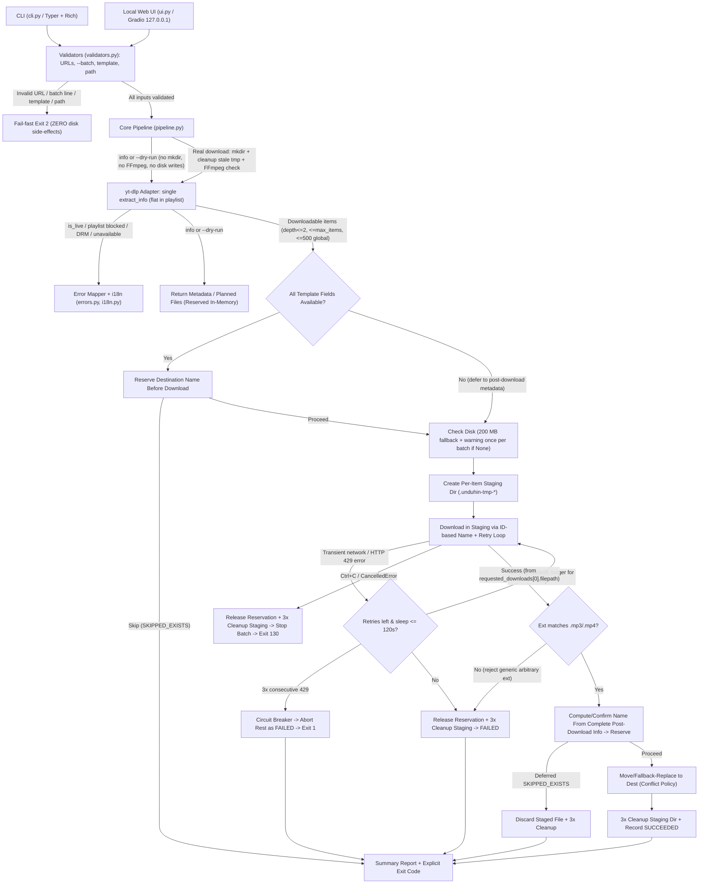
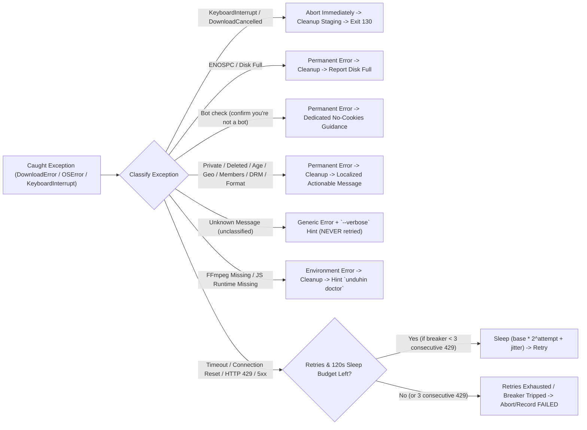

# `unduhin` Architecture & Design Plan (Approved Baseline)

`unduhin` is a local-first, open-source media downloader and converter (CLI + optional local Gradio web UI) that converts media URLs into MP3 (audio) or MP4 (video) files locally using `yt-dlp` (as a Python library), FFmpeg, and Deno.

> **Target environment:** Python `>=3.11` (developed and tested on Python 3.13 via `uv`).

---

## 1. Design Principles & Scope

### Core Goals
- **Local-only execution:** Runs entirely on the user's machine; no cloud proxy, no third-party ad-heavy converter sites, no telemetry.
- **Dual-audience UX:** Scriptable, predictable CLI for developers (`typer` + `rich`), and a minimal, human-friendly local web UI (`gradio` bound strictly to `127.0.0.1`) for non-technical users.
- **Bilingual (EN + ID):** Automatic detection from system locale with English fallback and explicit `--lang` / UI override.
- **Safety by construction:** Strict URL scheme allowlist (`http`/`https`), path-traversal containment, no `shell=True`, no `eval`/`exec`, no auto-execution of downloaded files, and no credential/cookie handling by default.

### Explicit Non-Goals
- User accounts, login flows, browser cookie extraction, or credential storage.
- DRM bypass or circumvention of protected streams.
- Bulk site scraping or autonomous crawling.
- Public web hosting, tunneling (`share=True`), or multi-tenant server deployments.
- Silent auto-updates or any form of telemetry/analytics.

---

## 2. Folder Structure

```text
unduhin/
├── pyproject.toml                  # PEP 621 metadata, MIT license, lower-bound yt-dlp[default], pinned ranges (incl. gradio>=6.0.0,<7.0.0), [ui]/[dev] extras, ruff/mypy/pytest config
├── LICENSE                         # MIT License (Copyright 2026 RobertusWilliamSusanto)
├── README.md                       # Bilingual documentation (EN top, ID bottom), uv-first OS setup, start/install numbers, legal notice, troubleshooting
├── .gitignore                      # Ignore venv, build artifacts, caches, downloaded test artifacts
├── .github/
│   └── workflows/
│       └── ci.yml                  # Ubuntu/Windows/macOS x Python 3.11-3.13 matrix (uv, ruff, mypy --strict, pytest without network)
├── docs/
│   ├── DESIGN.md                   # This architecture & design document
│   └── MANUAL_TEST.md              # Interactive smoke-test checklist (`M01`-`M17`) with Pass/Fail/Notes columns
├── src/
│   └── unduhin/
│       ├── __init__.py             # Package version and exported public metadata
│       ├── __main__.py             # Entry point for `python -m unduhin`
│       ├── cli.py                  # Lightweight lazy-importing Typer CLI (`download` + URL shortcut, `info`, `doctor`, `ui`, no-args help, TTY mode prompt, global error handler, `add_completion=False`)
│       ├── config.py               # Typed configuration models, enums, defaults (`~/Downloads/unduhin`, `MAX_FINAL_PATH_LENGTH = 240`), hardening bounds
│       ├── errors.py               # Domain exception hierarchy & error mapper (`yt-dlp`/OS exceptions -> localized error keys)
│       ├── i18n.py                 # Locale resolver (`--lang` > `UNDUHIN_LANG` > system locale/Windows LCID -> `en`), EN/ID catalog, safe formatting
│       ├── validators.py           # URL validator, `resolve_output_dir` (`--output-dir` > `UNDUHIN_OUTPUT_DIR` > `~/Downloads/unduhin`), 240-char total path truncation, batch parser, path containment
│       ├── doctor.py               # Two-tier checks: Required (Python, yt-dlp, FFmpeg -> exit 3) vs Recommended (Deno for YouTube, yt-dlp-ejs -> warn, exit 0) via `importlib.metadata`
│       ├── ytdlp_adapter.py        # Sole module importing `yt_dlp` (lazily inside extract/download only); builds safe `ydl_opts`
│       ├── pipeline.py             # Core orchestration (global cap, deferred full-metadata naming, 240-char fit, circuit breaker, staging cleanup retries, Ctrl+C abort)
│       └── ui.py                   # Optional Gradio 6 local UI (lazily loaded for `unduhin[ui]`, `127.0.0.1`, fixed launch output dir, flat accessible theme, pure handlers)
└── tests/
    ├── conftest.py                 # Shared fixtures (isolated tmp dirs, fake yt-dlp adapter, locale/env reset)
    ├── test_validators.py          # URL scheme rejection, output-dir precedence, 240-char path cap, allowlisted templates, hardlink/retry cleanup
    ├── test_i18n.py                # EN/ID translation parity, `UNDUHIN_LANG` precedence, Windows/POSIX locale mapping & fallback
    ├── test_doctor.py              # Two-tier dependency detection (required exit 3 vs Deno recommended exit 0), `yt-dlp` uv/pipx/pip hints
    ├── test_errors.py              # Classification corpus built from installed yt-dlp messages + bot check / DRM / unknown non-retryable
    ├── test_ytdlp_adapter.py       # Unit tests for `yt-dlp` option builder + skipped-by-default network test
    ├── test_pipeline.py            # Exit-code status split, deferred naming, 120s sleep cap, 429 breaker, 500 global cap, batch duplicate markers
    ├── test_cli.py                 # Lazy-import subprocess check, shortcut routing, no-args help, TTY mode prompt, global error/Ctrl+C, non-UTF-8 console, C1-C8
    └── test_ui.py                  # Gradio 6 launch hardening, server non-loopback egress socket guard, JS font audit notes, WCAG contrast math, cancel cleanup
```

---

## 3. Flow Diagrams

### 3.1 Main Architecture & Request Flow



### 3.2 Error Classification & Retry Decision Flow



---

## 4. Module Responsibilities & Boundaries

| Module | Responsibility | Typing / Isolation |
|---|---|---|
| `config.py` | Defines immutable dataclasses (`DownloadRequest`, `ItemResult`, `BatchSummary`, `MediaInfo`), enums (`MediaMode`, `ConflictPolicy`, `ItemStatus`, `ExitCode`), defaults (`get_default_output_dir() -> ~/Downloads/unduhin`), and hardening bounds (`MISSING_TEMPLATE_FIELD_PLACEHOLDER = "unknown"`, `MAX_FINAL_PATH_LENGTH = 240`, `MAX_TOTAL_SLEEP_PER_ITEM_SECONDS = 120.0`, `CONSECUTIVE_RATE_LIMIT_BREAKER = 3`, `MAX_TOTAL_ITEMS_GLOBAL = 500`, `STAGING_CLEANUP_RETRY_DELAYS = (0.2, 0.5, 1.0)`, `MAX_UI_URL_LENGTH = 2048`). | Pure stdlib, `mypy --strict` clean. |
| `i18n.py` | Resolves language priority (`--lang` > `UNDUHIN_LANG` > `LC_ALL`/`LC_MESSAGES`/`LANG`/`LANGUAGE` > `locale.getlocale()` > Windows LCID -> fallback `en`), stores EN/ID catalog (CLI welcome/shortcut/mode prompt, global error message, UI copy, doctor two-tier messages), and provides `t(key, lang=..., **kwargs)` cleanly. | Pure stdlib, `mypy --strict` clean. |
| `errors.py` | Defines `UnduhinError` hierarchy and maps verified `yt_dlp`/OS exceptions (`bot_check` before login/age, `members only`/`registered users`, `requested format is not available`/`no video formats found`, `try again later` -> `RateLimitError`, `HTTP Error 403/429/5\d\d`, DRM, unknown -> generic error + `--verbose` hint, NEVER retried). | Pure stdlib, `mypy --strict` clean. |
| `validators.py` | Validates URLs (`http`/`https` only), resolves output directory (`--output-dir` > `UNDUHIN_OUTPUT_DIR` > `~/Downloads/unduhin`) without touching disk, fits final filenames into total path limit (`<= 240` chars, rejecting over-deep folders up front), parses `--batch` files (UTF-8/BOM, <= 1 MB, <= 500 URLs, fail-fast exit 2), combines positional + batch URLs, checks `template_fields_available()`, renders allowlisted filenames, enforces path containment + `.mp3`/`.mp4` whitelist, reserves unique batch filenames in memory (preserving path-length ceiling even on `(N)` suffixes), handles `(OSError, NotImplementedError)` `os.link` fallback, checks disk space, and cleans stale `.unduhin-tmp-*` folders with 3x retry. | Pure stdlib, `mypy --strict` clean. |
| `doctor.py` | Two-tier offline environment checks via `importlib.metadata` and `shutil.which` (`shell=False`): **Required** (`Python >= 3.11`, `yt-dlp`, `FFmpeg` -> `MISSING` triggers exit `3`) vs **Recommended** (`Deno >= 2.3.0` for YouTube only + `yt-dlp-ejs` -> `WARN` with exit `0` when missing, explicitly noting non-YouTube downloads work without Deno). Provides `uv tool upgrade unduhin`, `pipx runpip unduhin install -U "yt-dlp[default]"`, and `pip install -U "yt-dlp[default]"` update instructions. | Pure stdlib + `importlib.metadata`, `mypy --strict` clean. |
| `ytdlp_adapter.py` | Sole module importing `yt_dlp` (strictly lazily inside `extract_info()` and `download()` so startup/doctor/help never load `yt_dlp`). Builds safe `ydl_opts` (no cookies/credentials, `noplaylist` / `playlist_items=f"1:{max_items+1}"` with `extract_flat="in_playlist"`, Deno JS runtime, H.264+AAC-preferring MP4 selector, FFmpeg MP3 postprocessor, explicit internal retry bounds). | Typed Protocol boundary; `yt_dlp.*` isolated here. |
| `pipeline.py` | Orchestrates `inspect_url()` and `run_download()`: validates ALL inputs BEFORE touching disk; resolves/enforces 240-char path ceiling (`output_dir` + filename + ext); enforces global cap (`500`); separates `SKIPPED_EXISTS` vs `SKIPPED_UNSUPPORTED`; defers final filename resolution to complete post-download metadata (`dl_result.info`); emits one batched `unknown_filesize` warning; enforces `120s` per-item sleep budget and 3-consecutive `RateLimitError` circuit breaker; retries staging cleanup 3x. | Depends only on `MediaAdapter` protocol, `mypy --strict` clean. |
| `cli.py` | Lightweight Typer frontend (`add_completion=False`, `pretty_exceptions_enable=False`, `pretty_exceptions_show_locals=False`) keeping `rich.progress`/`rich.table`/`doctor`/`pipeline`/`validators`/`ytdlp_adapter`/`errors`/`ui` lazily imported inside subcommands so `--version`, `--help`, no-arg, `doctor`, and `ui --help` never load `yt_dlp` or `gradio`. Supports shortcut `unduhin <url> [options]` (options placed after URL), bilingual no-args quick help (3 examples + `doctor`/`--help`), interactive TTY mode prompt when `--mode` omitted (non-TTY exits `2`), global unexpected-exception guard (no traceback without `--verbose`), `KeyboardInterrupt -> 130`, non-UTF-8/redirected stdout safety (`"日本語 🎵 test"`), and printing the absolute output folder path at summary end. | Thin presentation layer, typed. |
| `ui.py` | Optional local Gradio 6 Blocks interface (`unduhin[ui]`, pinned `>=6.0.0,<7.0.0`), lazily loaded after setting `GRADIO_ANALYTICS_ENABLED="False"` and `HF_HUB_DISABLE_TELEMETRY="True"`. Reuses `resolve_output_dir` (`--output-dir` > `UNDUHIN_OUTPUT_DIR` > `~/Downloads/unduhin`) fixed at launch, minimal single-URL MP3/MP4 form, `--port`/`--lang` (no `--host`, hardcoded `127.0.0.1`), `share=False`, `analytics_enabled=False`, `inbrowser=False`, `footer_links=[]`, `run_history=False`, `enable_monitoring=False`, `show_error=False`, `allowed_paths=[]`, event `api_visibility="private"`, `concurrency_limit=1`, cooperative `threading.Event` cancel wired to `hooks.is_cancelled`, pure `system-ui` stack, solid hex WCAG Light/Dark palette (`#80807A`/`#72726C`), 3-way `System`/`Light`/`Dark` switcher in `try/catch` `localStorage`. | Isolated optional dependency (`gradio`). |

---

## 5. Core Pipeline Pseudo-Code

```python
def run_job(request: DownloadRequest, adapter: MediaAdapter, hooks: PipelineHooks) -> BatchSummary:
    # 1. Validate ALL inputs (options, template allowlist, output path safety, ALL URLs) BEFORE touching disk
    validate_request_options(request)  # Checks bitrate, max_height, max_retries, 1 <= max_items <= 200, template
    resolved_output_dir = validate_output_dir_path(request.output_dir)  # Does NOT mkdir or touch disk
    validated_urls = [validate_url(raw_url) for raw_url in request.urls]  # Fail-fast exit 2 on any invalid URL

    summary = BatchSummary()

    # 2. Disk side-effects & FFmpeg check happen ONLY for real downloads (NEVER on --dry-run or info)
    if not request.dry_run:
        output_dir = ensure_safe_output_dir(resolved_output_dir)
        for err_msg in cleanup_stale_staging_dirs(output_dir):
            hooks.warn(err_msg)
        require_ffmpeg()
    else:
        output_dir = resolved_output_dir

    if any_looks_like_youtube(validated_urls) and not find_deno():
        hooks.warn(t("warn.deno_missing", lang=request.lang))

    # Track reserved final filenames across the entire batch so identically titled items never collide
    reserved_names: set[str] = set()

    total_emitted = 0
    unknown_filesize_count = 0
    consecutive_rate_limits = 0
    breaker_tripped = False

    for url_idx, url in enumerate(validated_urls):
        try:
            # 3. Single extract_info call (flat inside playlist to prevent N+1 calls)
            raw_info = adapter.extract_info(
                url,
                allow_playlist=request.allow_playlist,
                max_items=request.max_items,
                verbose=request.verbose,
            )

            # Flatten nested playlists up to depth 2, handle None/unavailable entries, cap at max_items
            items, playlist_warnings = expand_and_flatten_items(
                raw_info,
                allow_playlist=request.allow_playlist,
                max_items=request.max_items,
            )
            for w in playlist_warnings:
                hooks.warn(w)

            # Global cross-batch cap (default MAX_TOTAL_ITEMS_GLOBAL = 500)
            remaining_global = request.max_total_items - total_emitted
            if remaining_global <= 0:
                hooks.warn(t("warn.global_item_limit_reached", lang=request.lang, max_items=request.max_total_items))
                break
            if len(items) > remaining_global:
                items = items[:remaining_global]
                hooks.warn(t("warn.global_item_limit_reached", lang=request.lang, max_items=request.max_total_items))
            total_emitted += len(items)

            for item_idx, item in enumerate(items):
                if hooks.is_cancelled():
                    raise CancelledError("error.cancelled")

                if item.is_unavailable:
                    consecutive_rate_limits = 0
                    summary.add_skipped_unsupported(item.url or url, reason=t("error.playlist_entry_unavailable", lang=request.lang))
                    continue

                if item.is_live or item.live_status in {"is_live", "is_upcoming"}:
                    consecutive_rate_limits = 0
                    summary.add_skipped_unsupported(item.url, reason=t("error.live_stream_unsupported", lang=request.lang))
                    continue

                if item.is_drm:
                    consecutive_rate_limits = 0
                    summary.add_failed(item.url, reason=t("error.drm_protected", lang=request.lang))
                    continue

                # 4. Early skip/reservation ONLY when all template fields exist on pre-download metadata;
                # otherwise defer final naming to complete post-download metadata (dl_result.info).
                fields_complete = template_fields_available(item, request.filename_template)
                early_reserved_key: str | None = None
                early_planned_path: Path | None = None
                early_batch_dup = False
                if fields_complete:
                    target_name = render_allowlisted_filename(item, request.filename_template, request.mode)
                    early_planned_path, skip_item, early_reserved_key, early_batch_dup = reserve_destination(
                        output_dir,
                        target_name,
                        request.conflict_policy,
                        reserved_names,
                    )
                    if skip_item:
                        consecutive_rate_limits = 0
                        summary.add_skipped_exists(item.url, path=early_planned_path, reason=t("status.skipped_exists", lang=request.lang))
                        continue

                if request.dry_run:
                    consecutive_rate_limits = 0
                    preview_name = render_allowlisted_filename(item, request.filename_template, request.mode)
                    preview_path = early_planned_path or (output_dir / preview_name)
                    summary.add_planned(item.url, path=preview_path, info=item, is_batch_renamed=early_batch_dup)
                    continue

                # Check disk space; count unknown sizes for a single end-of-batch warning
                if item.filesize_approx is None:
                    unknown_filesize_count += 1
                check_free_disk_space_threshold(output_dir, estimated_bytes=item.filesize_approx)

                # 5. Download inside isolated staging dir using ID-based name (never user template)
                staging_dir = create_staging_dir(output_dir)
                item_reserved_key = early_reserved_key
                try:
                    result = download_with_retry(
                        adapter=adapter,
                        url=item.webpage_url or url,
                        request=request,
                        staging_dir=staging_dir,
                        hooks=hooks,
                    )
                    consecutive_rate_limits = 0
                    if result.codec_fallback_used:
                        hooks.warn(t("warn.mp4_codec_fallback", lang=request.lang))

                    downloaded_file = result.filepath  # From requested_downloads[0]["filepath"]
                    assert_within_directory(downloaded_file, staging_dir)
                    assert_allowed_extension(downloaded_file, request.mode)  # Only .mp3 / .mp4

                    # Resolve final filename from complete post-download metadata (merging non-empty fallbacks)
                    complete_info = merge_info_fallback(primary=result.info, fallback=item)
                    final_target_name = render_allowlisted_filename(complete_info, request.filename_template, request.mode)
                    if early_planned_path is not None and final_target_name.casefold() == early_planned_path.name.casefold():
                        planned_path = early_planned_path
                        is_batch_renamed = early_batch_dup
                    else:
                        if early_reserved_key is not None:
                            reserved_names.discard(early_reserved_key)
                        planned_path, deferred_skip, item_reserved_key, is_batch_renamed = reserve_destination(
                            output_dir, final_target_name, request.conflict_policy, reserved_names
                        )
                        if deferred_skip:
                            summary.add_skipped_exists(item.url, path=planned_path, reason=t("status.skipped_exists", lang=request.lang))
                            continue

                    final_path, moved = move_staged_file(
                        downloaded_file,
                        planned_path,
                        output_dir,
                        request.conflict_policy,
                        reserved_names,
                    )
                    if not moved:
                        if item_reserved_key is not None:
                            reserved_names.discard(item_reserved_key)
                        summary.add_skipped_exists(item.url, path=final_path, reason=t("status.skipped_exists", lang=request.lang))
                    else:
                        summary.add_succeeded(item.url, path=final_path, is_batch_renamed=is_batch_renamed)
                except RateLimitError as rl_exc:
                    if item_reserved_key is not None:
                        reserved_names.discard(item_reserved_key)
                    consecutive_rate_limits += 1
                    summary.add_failed(item.url, reason=localize_error(rl_exc, request.lang))
                    if consecutive_rate_limits >= CONSECUTIVE_RATE_LIMIT_BREAKER:
                        breaker_tripped = True
                        # Mark remaining items & URLs FAILED with rate-limit breaker reason
                        mark_remaining_rate_limited(summary, items[item_idx + 1 :], validated_urls[url_idx + 1 :], request.lang)
                        break
                except (KeyboardInterrupt, CancelledError):
                    if item_reserved_key is not None:
                        reserved_names.discard(item_reserved_key)
                    raise
                except Exception:
                    if item_reserved_key is not None:
                        reserved_names.discard(item_reserved_key)
                    raise
                finally:
                    # Guarantees 3x retry cleanup (0.2s, 0.5s, 1.0s) and user notice if removal fails
                    cleanup_path_with_retry(staging_dir, warn=hooks.warn, sleep_fn=hooks.sleep_fn)
            if breaker_tripped:
                break

        except (KeyboardInterrupt, CancelledError):
            # Must precede UnduhinError so cancellation halts the entire batch (exit 130)
            summary.interrupted = True
            break
        except RateLimitError as rl_exc:
            consecutive_rate_limits += 1
            summary.add_failed(url, reason=localize_error(rl_exc, request.lang))
            if consecutive_rate_limits >= CONSECUTIVE_RATE_LIMIT_BREAKER:
                mark_remaining_rate_limited(summary, (), validated_urls[url_idx + 1 :], request.lang)
                break
        except UnduhinError as exc:
            consecutive_rate_limits = 0
            summary.add_failed(url, reason=localize_error(exc, request.lang))

    if unknown_filesize_count > 0:
        hooks.warn(t("warn.unknown_filesize_batch", lang=request.lang, count=unknown_filesize_count))

    return summary


def download_with_retry(adapter, url, request, staging_dir, hooks) -> AdapterDownloadResult:
    attempt = 0
    total_slept = 0.0
    while True:
        if hooks.is_cancelled():
            raise CancelledError("error.cancelled")
        try:
            return adapter.download(...)
        except (KeyboardInterrupt, CancelledError):
            raise
        except Exception as raw_exc:
            mapped = classify_exception(raw_exc)
            # Only TransientNetworkError is retried; unknown errors become generic DownloadFailedError and exit immediately
            if isinstance(mapped, TransientNetworkError) and attempt < request.max_retries:
                base = request.rate_limit_backoff_seconds if isinstance(mapped, RateLimitError) else request.backoff_base_seconds
                delay = base * (2 ** attempt) + jitter(0.0, 0.5)
                if total_slept + delay <= MAX_TOTAL_SLEEP_PER_ITEM_SECONDS:
                    hooks.on_retry(attempt + 1, request.max_retries, delay, mapped)
                    sleep_interruptible(delay, hooks.is_cancelled, hooks.sleep_fn)
                    total_slept += delay
                    attempt += 1
                    continue
            raise mapped from raw_exc
```

---

## 6. Planned Exit Codes

| Exit Code | Meaning & Precedence |
|---|---|
| `130` | **Interrupted** (`Ctrl+C` / `SIGINT`, Windows `Ctrl+Break` / `SIGBREAK`, or UI cooperative Cancel), partial files cleaned up. **Takes precedence over `1`** even if earlier items failed. |
| `3` | **Missing required dependency** (FFmpeg not installed during real download, `unduhin doctor` detects missing required tool [`Python`, `yt-dlp`, `FFmpeg`], or `gradio` missing on `unduhin ui`). |
| `2` | **Invalid input** (invalid URL, invalid `--batch` file/line, unsafe template/path, over-deep output folder leaving insufficient filename budget `< 240` chars, invalid option bounds, missing `--mode` in non-TTY download, playlist URL without `--playlist` when nothing succeeded). Fails fast without side-effects. |
| `1` | **Partial or total runtime failure / unsupported skip / UI bind error / unexpected unhandled CLI exception** (at least 1 item `FAILED` or `SKIPPED_UNSUPPORTED`; UI server failed to bind port; or unexpected uncaught exception logged with `--verbose` hint). |
| `0` | **Success**: ALL items `SUCCEEDED` or `SKIPPED_EXISTS` (zero `FAILED` and zero `SKIPPED_UNSUPPORTED`), `unduhin doctor` with all required tools OK (even when recommended `Deno` / `yt-dlp-ejs` is missing and prints a YouTube-only warning), `info`, `--dry-run`, or no-args brief help. |

---

## 7. Major Risks, Mitigations & Specification Notes

1. **`yt-dlp` YouTube JS Challenge (`yt-dlp-ejs` + Deno):**
   - *Risk:* Recent `yt-dlp` requires both an external JS runtime (Deno >= 2.x recommended) **and** challenge solver scripts (`yt-dlp-ejs`). Installing bare `yt-dlp` without the `[default]` extra causes YouTube downloads to fail or omit formats unless `--remote-components` downloads external JS at runtime.
   - *Mitigation:* Depend on `"yt-dlp[default]"` in `pyproject.toml` (avoiding runtime remote JS fetches by default), detect both `deno` and `yt-dlp-ejs` in `unduhin doctor`, and verify the exact `js_runtimes` Python option structure from the installed `yt_dlp` source during Phase 1.

2. **Pure Playlist URLs vs `noplaylist=True`:**
   - *Risk:* In `yt-dlp`, `noplaylist: True` only disables playlists when a single video ID is also present (`watch?v=...&list=...`). A pure `/playlist?list=...` URL is still expanded as a playlist by `yt-dlp`.
   - *Mitigation:* Inspect `extract_info(..., download=False)` metadata (`_type == "playlist"`) before downloading and explicitly reject/skip when `--playlist` is not enabled.

3. **MP4 Codec Compatibility for Non-Technical Users:**
   - *Risk:* Merging `bestvideo+bestaudio` into `.mp4` often muxes VP9/AV1 video and Opus audio inside `.mp4`, which fails to play in QuickTime, iOS, Windows legacy players, and messaging apps.
   - *Mitigation:* Prefer H.264 (`avc1`) + AAC (`m4a`) streams (`ext:mp4:m4a`, `vcodec:h264`, `acodec:aac`) within the requested max height, falling back gracefully when unavailable and emitting a clear warning to the user when fallback codecs are used.

4. **Gradio 6 Telemetry, Network Exposure, Theme & Launch-Time Output Dir:**
   - *Risk:* Gradio enables anonymous analytics (`analytics_enabled`), version checks (`pkg-version`), `GoogleFont` / external avatar/meta assets, and default gradients/shadows (`LocalFont("Source Sans Pro")`, `input_shadow_focus`, `stat_background_fill`), or lets users pick arbitrary filesystem paths via `allowed_paths`.
   - *Mitigation (verified against `gradio==6.31.0` source):* Pin `"gradio>=6.0.0,<7.0.0"` (`Requires-Python >=3.11`, `py3-none-any`); set `GRADIO_ANALYTICS_ENABLED="False"` and `HF_HUB_DISABLE_TELEMETRY="True"` BEFORE importing `gradio`; configure `server_name="127.0.0.1"`, `share=False`, `analytics_enabled=False`, `inbrowser=False`, `footer_links=[]`, `run_history=False`, `enable_monitoring=False`, `show_error=False`, `allowed_paths=[]`; set event `api_visibility="private"` and `concurrency_limit=1`; build a pure `system-ui` custom `gr.themes.Base` + flat solid hex Light/Dark palette (`#80807A`/`#72726C` adjusted borders so contrast passes WCAG `>= 3.0:1`), override every default gradient/shadow/radius > 6px via `theme.set(...)` and minimal CSS, and keep `--output-dir` (`> UNDUHIN_OUTPUT_DIR > ~/Downloads/unduhin`) fixed read-only at launch time. Bundled `Index-Akn07EZk2.js` defines Google Fonts helper `ge()` only inside HF Spaces banner path (`Ee -> Te -> Z`) gated by `config.space_id` (`None` in local `Blocks.launch()`).

5. **Outdated `yt-dlp` Detection Without Telemetry:**
   - *Risk:* Checking PyPI/GitHub for the latest `yt-dlp` version on every run introduces unwanted network dependencies and conflicts with zero-telemetry principles.
   - *Mitigation:* Perform a purely offline calendar-version age check in `unduhin doctor` (comparing `yt_dlp.version.__version__` date against local clock, e.g., > 90 days old) and surface update instructions when extractor/signature errors occur.

6. **Path Traversal, Arbitrary Extractor Extensions & `Ctrl+C` Partial File Cleanup:**
   - *Risk:* Untrusted media titles (`../`, Windows reserved names `CON`/`NUL`, control chars), `yt-dlp`'s generic extractor writing `.html`/arbitrary extensions, or Windows file locks during `.unduhin-tmp-*` cleanup can compromise safety or leave stale files.
   - *Mitigation:* Pass only an ID-based template into `yt-dlp` inside a per-item `.unduhin-tmp-*` staging dir, render the final filename ourselves from an explicit field allowlist (`title`, `id`, `uploader`, `upload_date`, `ext`), verify `.mp3`/`.mp4` extension whitelist and `resolved_path.is_relative_to(output_dir.resolve())` before moving, clean up stale `.unduhin-tmp-*` folders at startup (notifying if deletion fails), and catch `CancelledError` before `UnduhinError` to halt batches cleanly with exit `130`.

7. **Strict Typing Across Untyped Third-Party Libraries:**
   - *Risk:* `yt-dlp` and `gradio` lack complete PEP 561 type annotations, which can break `mypy --strict`.
   - *Mitigation:* Isolate `yt_dlp` inside `ytdlp_adapter.py` and `gradio` inside `ui.py` behind clean typed interfaces, keeping all core modules (`config`, `validators`, `errors`, `i18n`, `doctor`, `pipeline`) strictly typed under `mypy --strict`.

8. **Future Optimization — Double-Extraction (`extract_info` then `download`):**
   - *Note:* The current pipeline performs metadata inspection (`extract_info(..., download=False)`) before downloading (`ydl.download(...)`) so it can cleanly enforce playlist, live-stream, DRM, disk-space, and dry-run checks. Optimizing away the second extraction by passing `process_ie_result` / reusing info dicts is deferred as a post-Phase 1 optimization.
